<!-- ─────────────────────── HERO ─────────────────────── -->
<p align="center">
  
</p>

<p align="center">
  
  <a href="https://www.linkedin.com/in/shubham-s-kulkarni-8a5a271bb"></a>
  <a href="mailto:shubhamkulkarni857@gmail.com"></a>
</p>

<p align="center">
  <b>I build pipelines — both kinds.</b><br/>
  The ones that move payment files between banks, and the ones that take code from <code>git push</code> to a running container.
</p>

## 👨‍💻 About Me

```yaml
# application-shubham.yml
spring:
  profiles:
    active: backend, devops
engineer:
  name: Shubham Shekhar Kulkarni
  role: Backend Java Developer
  title: Assistant System Analyst
  company: C-Edge Technologies
  domain: Banking & payments
  experience: ~4 years
  based: Thane, Maharashtra, India
```

- **Payments backend.** I build Spring Boot services that generate, encrypt, sign and exchange payment files.
- **Legacy → modern.** Much of my work is modernization: plain JDBC → Spring JDBC/JPA, stored-procedure logic → scheduled Java jobs.
- **Production-minded.** Cutoff windows, bank-wise fault isolation, signed and encrypted file exchange, CVE patching — the unglamorous details that keep money moving.
- **DevOps by choice.** Certified in Linux, Shell Scripting, Docker and AWS & DevOps; now building CI/CD and DevSecOps pipelines in public.
- **Path so far.** Software Developer Intern → ASA Trainee → Assistant System Analyst.
- **Ask me about** Spring Boot batch jobs, payment file formats, SFTP + PGP integrations, Docker and GitHub Actions.

## 🧰 Tech Stack

<p align="center">
  <picture>
    <source media="(prefers-color-scheme: light)" srcset="https://skillicons.dev/icons?i=java,spring,hibernate,maven,idea,git,github&theme=light" />
    
  </picture>
  <br/>
  <picture>
    <source media="(prefers-color-scheme: light)" srcset="https://skillicons.dev/icons?i=linux,ubuntu,bash,docker,githubactions,jenkins,aws,postgres&theme=light" />
    
  </picture>
</p>

## ☕ Backend Development

- **Core** — `Java 8 / 21` `Spring Boot` `Spring Data JPA` `Spring JDBC` `Hibernate` `Lombok` `Log4j2`
- **Integrations & security** — `SFTP (Spring · JSch · sshj)` `PGP` `CMS / PKCS#7 signing` `BouncyCastle`
- **Batch & concurrency** — `Scheduled jobs` `Multithreading` `ThreadLocal context` `Per-bank fault isolation` `Config caching`
- **Files & data** — `Fixed-width payment files` `Apache POI` `OpenCSV` `xlsx · csv · ods`

## 🐳 DevOps & Cloud

<sub>🟢 at work &nbsp;·&nbsp; 🟠 hands-on — projects &amp; certifications &nbsp;·&nbsp; ⚪ learning / up next</sub>

- 🟢 `Maven builds` `java -jar batch services` `Job scheduling` `SFTP / SSH` `CVE remediation`
- 🟠 `Linux` `Bash` `Docker` `Docker Compose` `GitHub Actions` `Docker Hub` `Jenkins (Groovy)` `AWS`
- ⚪ `Kubernetes` `Helm` `Argo CD` `Terraform` `Ansible` `SonarQube` `OWASP ZAP` `Prometheus` `Grafana`

#### 🚀 Featured — [DevBoard: a containerized 3-tier app with CI](https://github.com/ShubhamK0816/tws_devboard)

React (Vite) + Go API + PostgreSQL on one Docker network: a single `docker compose up`, `.env`-driven config, and a GitHub Actions pipeline on every push to `main`:

```text
push → npm ci → lint → test
     → docker build → push to Docker Hub
next → SonarQube gate · OWASP ZAP scan
```

#### 📅 Featured — [#90DaysOfDevOps: a day-by-day DevOps challenge](https://github.com/ShubhamK0816/90DaysOfDevOps)

TrainWithShubham's hands-on challenge: one task a day for 90 days, from Linux and shell scripting through Docker, AWS and CI/CD to Kubernetes, Terraform and observability, ending in an end-to-end capstone. My fork holds my learning plan and day-by-day work.

## 🗄️ Databases

-  native SQL through Spring Data JPA, PL/SQL, BLOB handling, Oracle 21c XE for local development
-  containerized, with schema and seed scripts loaded on first start

## 🛠️ Tools & Platforms

<p>
  
  
  
  
  
  
</p>

## 🏅 Certifications

<p>
  
  
  
  
  
</p>

## 🎯 Current Focus

- **#90DaysOfDevOps** (TrainWithShubham) — Linux → Docker → CI/CD → Kubernetes → Terraform → observability, tracked in my fork.
- **DevSecOps on DevBoard** — adding a SonarQube quality gate (self-hosted on EC2) and an OWASP ZAP scan to the pipeline.
- **Java depth** — JVM & GC internals, the Java Memory Model, Spring Boot auto-configuration, transaction management.

**Roadmap**

- [x] Certified: Core Java · Linux · Shell Scripting · Docker · AWS & DevOps
- [x] 3-tier app running on Docker Compose
- [x] CI with GitHub Actions → Docker Hub
- [ ] SonarQube + OWASP ZAP stages in CI
- [ ] Kubernetes · Helm · Argo CD (GitOps)
- [ ] AWS infrastructure with Terraform
- [ ] A Spring Boot service shipped end-to-end: Docker → CI/CD → AWS

## 📊 GitHub Stats

<p align="center">
  <picture>
    <source media="(prefers-color-scheme: light)" srcset="https://raw.githubusercontent.com/ShubhamK0816/ShubhamK0816/stats/stats-light.svg" />
    
  </picture>
</p>

## 📈 Contribution Metrics

<p align="center">
  <picture>
    <source media="(prefers-color-scheme: light)" srcset="https://streak-stats.demolab.com/?user=ShubhamK0816&background=FFFFFF&border=D0D7DE&stroke=D0D7DE&ring=3D7A1E&fire=B45309&currStreakNum=1F2328&sideNums=1F2328&currStreakLabel=3D7A1E&sideLabels=57606A&dates=57606A&border_radius=10" />
    
  </picture>
</p>

<p align="center">
  <picture>
    <source media="(prefers-color-scheme: light)" srcset="https://raw.githubusercontent.com/ShubhamK0816/ShubhamK0816/snake/snake-light.svg" />
    
  </picture>
</p>

## ⚡ Fun Facts

- Fixed-width file formats keep you humble — one digit of zero-padding can break an entire file.
- This profile started as a Jenkins + Groovy playground (`my_first_repo`). Today GitHub Actions draws the stats and the snake above.
- `java -jar` at work, `docker compose up` at home — the roadmap's last box merges the two.

## 🤝 Let's Connect

<p align="center">
  <a href="https://www.linkedin.com/in/shubham-s-kulkarni-8a5a271bb"></a>&nbsp;&nbsp;
  <a href="mailto:shubhamkulkarni857@gmail.com"></a>
</p>

<p align="center">
  📧 <a href="mailto:shubhamkulkarni857@gmail.com">shubhamkulkarni857@gmail.com</a> &nbsp;·&nbsp; 📍 Thane, Maharashtra
</p>

<p align="center"><sub><i>Two kinds of pipelines. One standard: they run on time.</i></sub></p>
